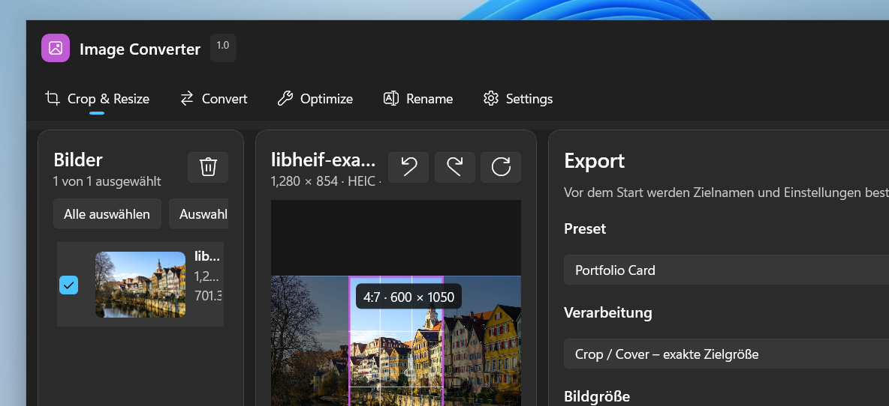

# Image Converter

Image Converter ist eine lokale Windows-11-Anwendung zum Zuschneiden, Skalieren,
Konvertieren, Optimieren und Umbenennen von Bildern. Die Oberfläche basiert auf
WinUI 3 und ist für einen schnellen Workflow mit einzelnen Bildern und größeren
Ordnern ausgelegt.

Die Bildverarbeitung findet vollständig lokal statt. Die Anwendung benötigt im
normalen Betrieb weder ein Benutzerkonto noch eine Internetverbindung.



## Funktionen

- übersichtlicher WinUI-3-Arbeitsbereich mit System-, Light- und Dark-Theme
- Dateiliste mit Vorschau, Dateiname, Auflösung, Format und Dateigröße
- JPG/JPEG, PNG, WebP, HEIC/HEIF, AVIF, TIFF/TIF und BMP als Eingabe
- WebP, JPEG, PNG, AVIF, TIFF, BMP und GIF als Ausgabe
- klar getrennte Einstellungen für Größe/Zuschnitt, Format/Kompression und Speichern
- Originalgröße ohne versteckte Preset-Skalierung, proportional einpassen,
  exakter Crop oder bewusstes Strecken
- manueller Crop mit acht Ziehpunkten, Drag, Mausrad, Slider sowie
  Pfeil-/WASD-/R-Tastatursteuerung
- eigener, dauerhaft gespeicherter Crop-Zustand pro geladenem Bild
- Presets für Portfolio Card (600 × 1050), Web Hero und Original → WebP
- Qualitätsregler, optimierte WebP-Kodierung und testkodierte Dateigrößen-Schätzung
- wahlweises Behalten von Transparenz oder weißer/schwarzer Hintergrund
- Export des aktuellen, der ausgewählten oder aller Bilder
- Batch-Export mit Fortschritt, Einzelergebnissen und Fehlerfortsetzung
- Export-Namensschema und sichere automatische Kollisionsbehandlung
- Rename-Vorschau mit Sortierung und zweiphasigem Umbenennen
- wahlweises Behalten oder Entfernen von EXIF- und GPS-Metadaten
- asynchrone Thumbnail-/Preview-Erzeugung und hochwertige Verarbeitung erst
  beim Export
- lokale Einstellungen, Diagnoseberichte und technische Logs
- Wiederherstellung der zuletzt geöffneten Bilder, Auswahl und Zuschnitte
- integrierte, SHA-256-geprüfte Updates über GitHub Releases

## Installation für Anwender

Releases stellen `ImageConverter-Setup.exe` bereit. Der Installer installiert
die vollständige self-contained Publish-Ausgabe pro Benutzer nach
`%LOCALAPPDATA%\Programs\Image Converter`, legt einen Startmenü-Eintrag an und
kann optional eine Desktop-Verknüpfung erstellen. Auf dem Zielrechner werden
weder .NET noch Visual Studio oder Python benötigt.

Ab Version 1.1 prüft die App auf Wunsch selbst auf neue GitHub-Releases. Ein
verfügbares Update kann direkt in der App heruntergeladen, per veröffentlichter
SHA-256-Prüfsumme verifiziert und installiert werden.

> Hinweis: Öffentliche Builds sind erst dann vertrauenswürdig signiert, wenn die
> Release-Pipeline mit einem Code-Signing-Zertifikat konfiguriert wurde. Die
> Signaturprüfung oder Sicherheitssoftware sollte nicht umgangen werden.

## Entwicklung

Voraussetzungen:

- Windows 11 x64
- .NET SDK 9.0.307 oder kompatibel (das Projekt zielt auf .NET 8)
- optional Inno Setup 6 zum Erzeugen der Setup-Datei

```powershell
dotnet restore ImageConverter.sln -p:Platform=x64
dotnet build ImageConverter.sln -c Release -p:Platform=x64 --no-restore
dotnet test tests/ImageConverter.Core.Tests/ImageConverter.Core.Tests.csproj `
  -c Release -p:Platform=x64 --no-build --no-restore
```

Ein vollständiger lokaler Release-Build:

```powershell
.\scripts\build-release.ps1 -Version 1.1.1
```

Ohne lokal installiertes Inno Setup:

```powershell
.\scripts\build-release.ps1 -Version 1.1.1 -SkipInstaller
```

Build-Logs werden bewusst unter `%TEMP%` abgelegt und nicht als Publish-Inhalt
gebündelt. Der Installer kopiert den kompletten Ordner `artifacts\publish` und
nicht lediglich die AppHost-EXE.

## Projektstruktur

```text
src/ImageConverter.App/        WinUI-3-Oberfläche und ViewModels
src/ImageConverter.Core/       Modelle und lokale Anwendungsdienste
tests/ImageConverter.Core.Tests/ automatisierte Unit- und Integrationstests
installer/                     Inno-Setup-Definition
scripts/                       reproduzierbarer Release-Build
docs/                          Architektur- und Testdokumentation
.github/workflows/             CI- und Release-Pipeline
```

Weitere Details stehen in [Architektur](docs/ARCHITECTURE.md),
[Tests](docs/TESTING.md) und [Beitragen](CONTRIBUTING.md).

## Datenschutz und Sicherheit

Bilddateien verlassen die Anwendung nicht. Für Website-Exporte wird das
Entfernen von GPS-Daten empfohlen. Sicherheitsprobleme bitte gemäß
[SECURITY.md](SECURITY.md) melden.

## Lizenz

Der eigene Quellcode steht unter der [MIT-Lizenz](LICENSE). Abhängigkeiten und
deren Lizenzhinweise sind in [THIRD-PARTY-NOTICES.md](THIRD-PARTY-NOTICES.md)
und im Ordner `licenses` dokumentiert.
